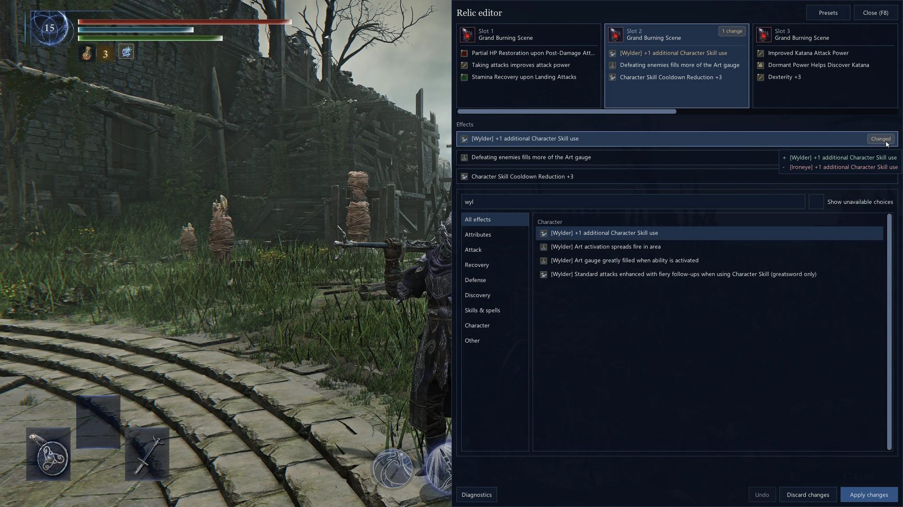
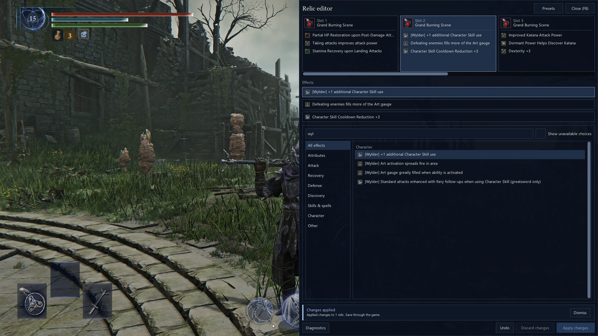
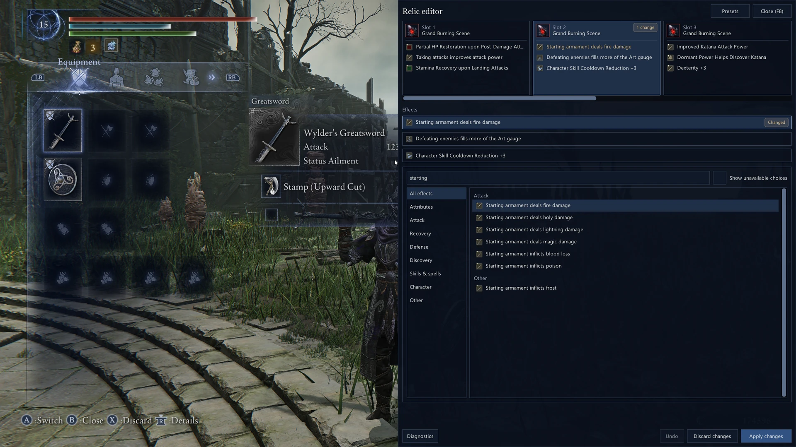
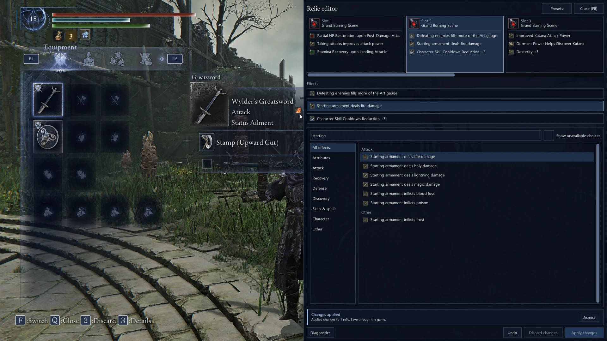
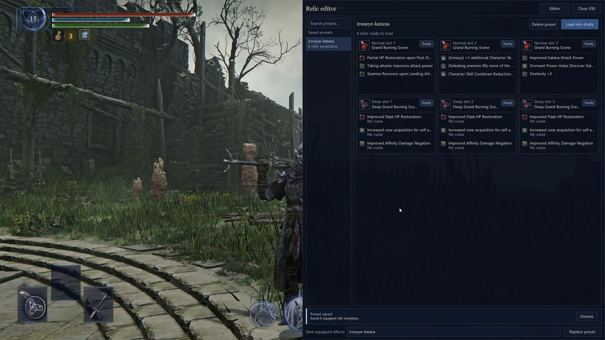
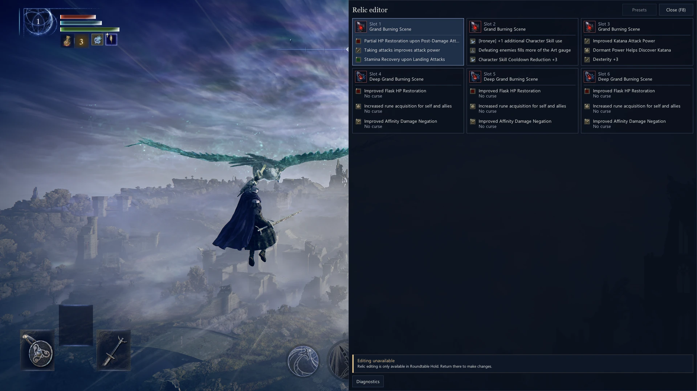

# ERN Relics

An in-game relic editor for **Elden Ring Nightreign**. Change equipped
relic effects at Roundtable Hold, review your changes, and apply them without
leaving the game.

- Edit normal relic effects and Deep Relic effects with their paired curses.
- Search effects and check combinations against the active roll rules.
- Stage changes across slots, apply them together, and undo the last batch.
- Save equipped effects as presets and preview compatibility before loading them.

Effect choices follow the roll rules in your active Mod Engine 3 profile.

## Screenshots

Effect search with a preview of the pending replacement.

More screenshots

Applied relic changes with confirmation in the editor.

Starting armament effects alongside the game's equipment screen.

An applied fire damage effect reflected in the equipment screen.

A saved preset with normal and Deep Relic effects across six slots.

Equipped relics remain visible during expeditions, with editing limited to
Roundtable Hold.

[Screenshot sources and usage terms](docs/screenshots/README.md).

## Install

Requires 64-bit Windows, Elden Ring Nightreign with executable file version
**1.3.3.0**, and [Mod Engine 3](https://github.com/garyttierney/me3/releases).
Check the file version in `nightreign.exe` Properties under **Details**. Other
executable versions stay read only.

Use an offline ME3 profile with Easy Anti-Cheat disabled. Back up your save before
editing.

1. Download the ERN Relics ZIP from the project's release page or Nexus Mods listing.
2. Drag and drop the ZIP into ME3.
3. Click **Merge**.

The release ZIP includes a SHA-256 checksum. Attested CI rebuilds also publish
GitHub build provenance, a signed tagged-source record, and downloadable Sigstore
bundles. Follow the [release verification instructions](docs/development.md#release-attestations-and-rebuilds)
to check the workflow and source commit before installing.

## Edit relics

1. Launch your profile and load a character in **Roundtable Hold**.
2. Press **F8** and select an equipped relic.
3. Select an effect or paired curse, then choose a replacement. Use **No curse**
   to clear the selected curse.
4. Review your drafts and click **Apply changes**.

Apply updates your relics immediately. Once the game saves your character, those
changes persist after restarting.

Drafts remain as you switch slots. **Discard changes** clears unapplied drafts.
**Undo** restores the last applied batch. Returning to the title screen or changing
character clears drafts and Undo. If Apply or Undo stops partway, completed changes
stay in place and the overlay reports the failure.

Only rolled relics are editable. The editor cannot create relics, change their
color, or edit unequipped inventory. Apply requires a valid roll. Effects that
trigger at character or expedition start still follow the game's normal timing.

The overlay captures keyboard and mouse input while open. It does not pause the
game or block controller input.

## Use presets

Open **Presets** and click **Save preset** after entering a name to capture your
equipped effects. Unapplied drafts and locked or invalid relics are omitted.
Select a preset to preview compatibility, then click **Load into drafts** and
review the changes before applying. Presets use your currently equipped relics.
Files live in `presets/` beside the DLL.

## Configuration and troubleshooting

Set the hotkey and initial visibility in [ern-relics.ini](config/ern-relics.ini).
Keep the default reader settings for supported editing.

Open **Diagnostics** to see why editing is locked or assets are missing.
For error details, check `ern-relics.log` beside the DLL.

| Problem | What to check |
|---|---|
| No log file | DLL path in the launched ME3 profile and installation folder permissions |
| No overlay | `load_early = true` and other graphics overlays |
| Editing is locked | The reason in Diagnostics and a character at Roundtable Hold |
| Numeric labels or placeholder icons | Asset warnings in Diagnostics |
| Regulation changed | Restart the game after changing `regulation.bin` |

## Contribute

The [development guide](docs/development.md) covers setup, builds, and testing.
The [architecture overview](docs/architecture.md) maps the code and runtime flow.

## License

[MIT](LICENSE), with [third-party notices and research credits](ThirdPartyNotices.txt).
Game imagery in the [screenshots](docs/screenshots/README.md) retains its owners'
rights and is not covered by the project's MIT license.
This community project is unaffiliated with FromSoftware and Bandai Namco.
